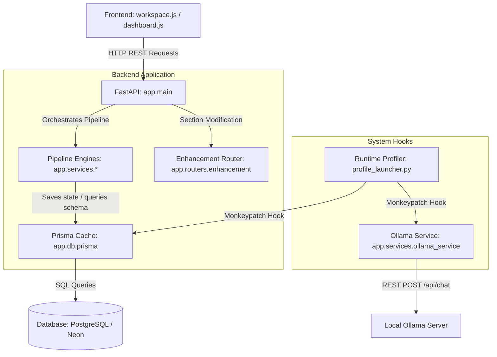

# 02. System Architecture & Flow

The AI Planning Agent operates as a **unidirectional pipeline** where project state is sequentially enriched across several specialized stages. The coordination of this pipeline occurs via a backend API, which caches and persists data to a database.

---

## 1. High-Level Architecture Topology
The following diagram illustrates how the frontend client, the FastAPI application, the custom telemetry profiler, and the database boundaries interact:



---

## 2. In-Memory Database Caching Layer
To prevent slow network round-trips to the database during the 8-stage pipeline execution, the system uses an in-memory caching mechanism:
* **File:** `app/db/prisma.py`
* **Workflow:**
  1. The first pipeline stage fetches the `Project` model and caches it using `set_cached_project(project_id, project)`.
  2. Subsequent stages (e.g. `estimation_engine`, `schedule_engine`) query the cache using `get_cached_project(project_id)`.
  3. If cache hits are found, the engines run calculation loops directly on memory.
  4. Once updates/re-generations are saved, `clear_project_cache(project_id)` is invoked to invalidate the stale state.

---

## 3. External LLM Communications Structure
All natural-language planning queries route through `app.services.ollama_service`:
* **JSON Schema Enforcement:** The system appends explicit system prompts (e.g. `"You are an expert editor. You only output valid JSON matching the schema"`) and output constraints.
* **Fallback Mechanisms:** In cases where Ollama wraps JSON in markdown blocks (e.g. ` ```json ... ``` `), the backend pre-processes the string inside `app/routers/enhancement.py` to extract the raw JSON list before parsing.
