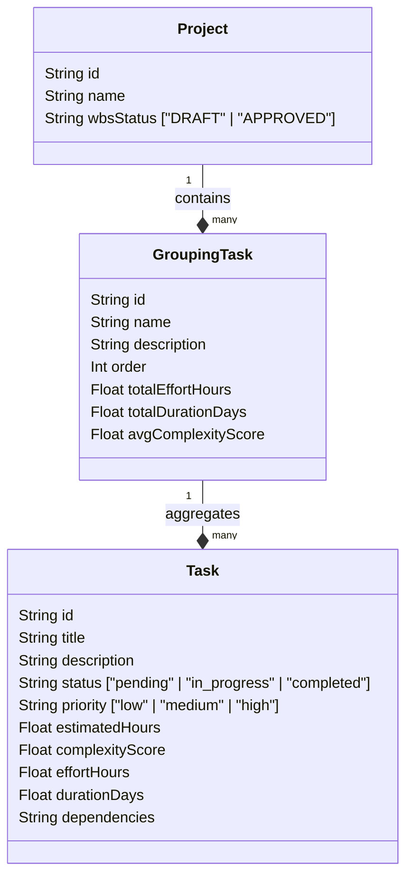
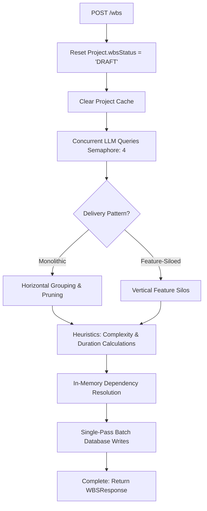

# 04d. Work Breakdown Structure (WBS) Engine & Lifecycle Reference

The **Work Breakdown Structure (WBS) Engine** (`app/services/wbs_engine.py`) and its associated routers coordinate the decomposition of requirements into actionable milestones and tasks. It supports dual delivery patterns (monolithic and feature-siloed), an advanced **Draft → Approved** review lifecycle, real-time manual edits, AI-driven enhancement prompts, and automated dependency repairs.

---

## 1. Architectural Topology & Relational Models

The WBS is structured around three primary database models defined in the Prisma schema:



* **`Project.wbsStatus`:** Tracks the lifecycle state of the plan. New or regenerated projects default to `"DRAFT"`. Approving the plan transitions it to `"APPROVED"`.
* **`GroupingTask` (Milestones/Phases):** High-level deliverables. In monolithic architecture, these correspond to horizontal lifecycle phases; in feature-siloed architecture, they correspond to vertical feature groups.
* **`Task`:** Granular technical deliverables. Tasks store mathematical complexity, estimated effort hours, assignee details, status, and dependency graphs (stored as JSON arrays of parent task UUIDs).

---

## 2. Plan Generation Flow (`wbs_engine.py`)

The generation of a WBS is the third stage of the planning pipeline. It runs asynchronously and performs the following operations:



### Key Phases:
1. **Concurrent LLM Extraction:** Queries are sent to the local Ollama LLM in parallel (throttled with an `asyncio.Semaphore(4)`) to extract milestones and technical tasks for each feature.
2. **Delivery Consolidation & Pruning:**
   * **Monolithic:** Filters out feature-specific deployment or boilerplate tasks. Consolidates cross-cutting tasks (like database setups and E2E testing) under Milestone 1 (`shared` context) and maps feature-specific tasks to the corresponding milestone phases.
   * **Feature-Siloed:** Structures tasks directly under milestones mapped to feature titles.
3. **Metric Heuristics:**
   * Complexity is calculated dynamically based on description length, technical keywords, and dependency count.
   * Total effort hours and duration days are computed using standard project management sizing algorithms:
     $$\text{Duration (Days)} = \text{ceil}\left(\frac{\text{Task Effort Hours}}{\text{Available Developers} \times \text{Productive Hours/Day}}\right)$$
4. **In-Memory Dependency Resolution:** Resolves task-to-task dependency titles into concrete UUID mappings in-memory before writing them to the database.

---

## 3. Draft → Approved Review Lifecycle

The planning agent implements a state-transition lifecycle to give users full control over when the WBS is promoted to the active project plan:

```
                  [ Pipeline Run / POST /wbs ]
                               │
                               ▼
                        ┌──────────────┐
                        │    DRAFT     │◄─────────┐ (Regenerate / Edit)
                        └──────┬───────┘          │
                               │                  │
                      [ POST /wbs/approve ]       │
                               │                  │
                               ▼                  │
                        ┌──────────────┐          │
                        │   APPROVED   ├──────────┘ (Regenerate)
                        └──────┬───────┘
                               │
            Downstream Stages  ▼ (Unlock Calculations)
         [ Estimation, Resources, Sprints, Validation ]
```

### Lifecycle Rules:
* **Gating Checks:** Downstream generation POST endpoints (`/estimate`, `/resource-plan`, `/schedule`, `/validate`) query `verify_wbs_approved(project_id, is_pipeline_run)`. If the status is not `"APPROVED"`, the request is blocked with an `HTTP 400 Bad Request` to prevent calculation runs against stale drafts.
* **Initial Pipeline Bypass:** During the initial end-to-end plan generation, the frontend passes `is_pipeline_run: true` to bypass approval restrictions and generate draft calculations for user preview.
* **Transition (`POST /wbs/approve`):** Sets `wbsStatus = "APPROVED"` and automatically runs schedule leveling and validation in the background.

---

## 4. AI-Driven Enhancement Engine

Enhancements are targeted, prompt-driven modifications of the WBS using the **Section Enhancement Router** (`app/routers/enhancement.py`):

1. **Prompt Enrichment:** Ambiguous user feedback is translated into detailed engineering constraints before execution.
2. **Concurrent Segment Regenerations:** The router splits the WBS, queries the LLM concurrently on a milestone-by-milestone basis, and replaces only modified tasks to maintain database references.
3. **Collision & Dependency Repair:**
   * Checks incoming task IDs against existing database records to prevent database constraint crashes.
   * Maps colliding IDs to new unique UUIDs and updates the task dependency arrays (`dependencies` JSON strings) in-flight.
4. **Transaction Backups:** Before making modifications, the WBS state is backed up to `ProjectBackup`. If the update fails, a rollback restores the previous state, preventing project planning corruption.

---

## 5. Manual Editing Engine

Users can manually edit any WBS task details (titles, descriptions, hours, priority, status) by clicking the edit pencil (`✏️`) icon next to WBS tree items in the workspace.

* **Backend Recalculation:** When a manual edit is saved via `PATCH /wbs/tasks/{task_id}`, the backend automatically re-runs complexity, effort, and duration sizing calculations:
  ```python
  complexity = _compute_task_complexity(title, description, len(dependencies))
  effort, duration = _compute_effort(estimated_hours, complexity, productive_hours_per_day)
  ```
* **Downstream Reschedule Sync:** Manual edits trigger schedule recalculations (`generate_schedule`) and validation check runs (`run_validation`) in the background, updating sprint charts and expected deadlines instantly.
* **Dual-State Availability:** Pencil editing triggers are available in both **Draft** and **Approved** states.
* **HTML Character Escaping:** Frontend text attributes are escaped using character mapping (e.g. converting `"` to `&quot;`, `'` to `\'`, and newlines to `\n`) to prevent javascript syntax breaks in inline HTML event bindings.
