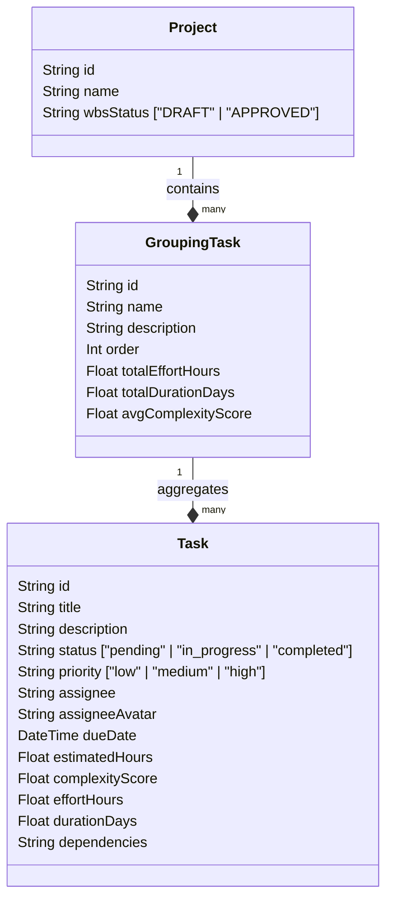
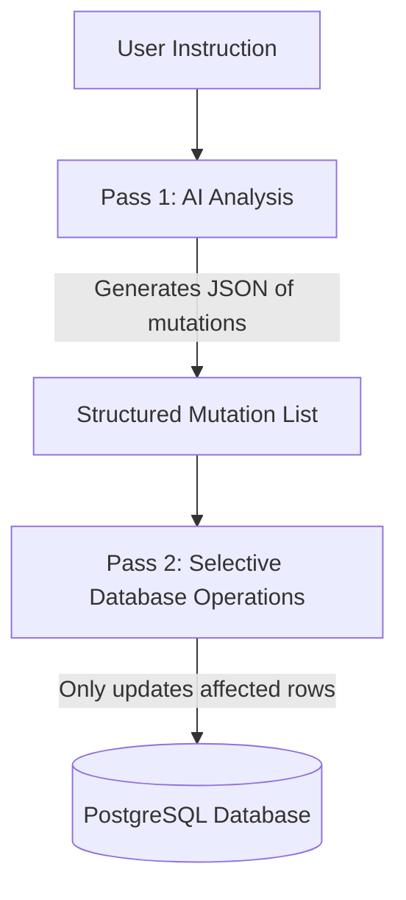
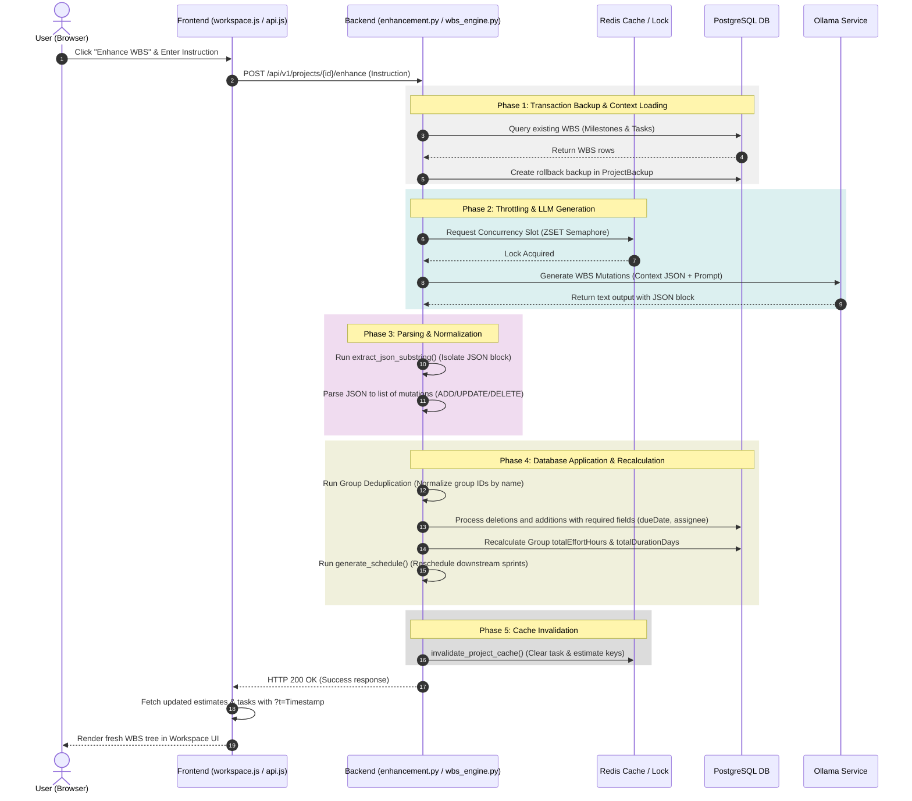

# 04d. Work Breakdown Structure (WBS) Engine & Lifecycle Reference

The **Work Breakdown Structure (WBS) Engine** (`app/services/wbs_engine.py`) and its associated routers coordinate the decomposition of requirements into actionable milestones and tasks. It supports dual delivery patterns (monolithic and feature-siloed), an advanced **Draft → Approved** review lifecycle, real-time manual edits, AI-driven enhancement prompts, and automated dependency repairs.

---

## 1. Relational Database Schema & Topology

The WBS structure is persistent in PostgreSQL using the following relational mapping:



* **`Project.wbsStatus`:** Controls review gates. Newly generated plans default to `"DRAFT"`. Promoted plans transition to `"APPROVED"`.
* **`GroupingTask` (Milestones/Phases):** Aggregates high-level project segments. These map to horizontal phases (monolithic) or vertical features (feature-siloed).
* **`Task`:** Technical deliverables. Tasks store complexity heuristics, estimated hours, assignee details, status, and dependency graphs (stored as JSON arrays of parent task UUIDs).

---

## 2. Draft → Approved Lifecycle & Router Gating

To protect stable project plans from accidental overwrites, the agent enforces a state-transition lifecycle:

```
                  [ Pipeline Run / POST /wbs ]
                               │
                               ▼
                        ┌──────────────┐
                        │    DRAFT     │◄─────────┐ (Regenerate / Edit)
                        └──────┬───────┘          │
                               │                  │
                      [ POST /wbs/approve ]       │
                               │                  │
                               ▼                  │
                        ┌──────────────┐          │
                        │   APPROVED   ├──────────┘ (Regenerate)
                        └──────┬───────┘
                               │
            Downstream Stages  ▼ (Unlock Calculations)
         [ Estimation, Resources, Sprints, Validation ]
```

### Routing Rules & Gates:
* **Downstream Access Blocking:** All downstream POST endpoints (`/estimate`, `/resource-plan`, `/schedule`, `/validate`) invoke `verify_wbs_approved(project_id, is_pipeline_run)`. If the project's status is `"DRAFT"`, downstream requests are rejected with `HTTP 400 Bad Request`.
* **Initial Pipeline Bypass:** During the initial end-to-end plan generation, the client passes `is_pipeline_run: true` to allow downstream engines to calculate draft preview data.
* **WBS Promotion (`POST /wbs/approve`):** Promotes `wbsStatus` to `"APPROVED"`, invalidates the Redis cache, and automatically runs scheduling and validation in the background.

---

## 3. High-Speed Redis Caching & Invalidation Hooks

The backend leverages an ephemeral high-speed memory layer (`app/db/redis.py`) to bypass database latency and accelerate UI reads.

### Connection Architecture & Graceful Degradation:
* **Connection Pool Management:** Built using `redis.asyncio` and tied to the FastAPI lifespan events. Sockets are opened on startup and closed cleanly during server shutdown.
* **Graceful Degradation (`safe_redis_call`):** All Redis interactions are wrapped in exception catch blocks. If Redis drops offline, the system logs warnings and automatically falls back to raw database queries without crashing.
* **Static Key Namespace:** Cache keys are compiled using a static, deterministic prefix: `wbs:project:{project_id}:{suffix}`. This ensures cache keys align perfectly across different startup contexts.

### Cache Invalidation Hooks:
Cache keys (`wbs:project:{id}:tasks` and `wbs:project:{id}:estimates`) are automatically invalidated (`delete`) during:
* Initial WBS generation (`POST /wbs`).
* WBS Approval (`POST /wbs/approve`).
* Manual Task Edits (`PATCH /wbs/tasks/{task_id}`).
* AI Enhancements (`POST /enhance`) and Reversions (`POST /revert`).

---

## 4. Distributed Concurrency Protection (ZSET Semaphore)

To protect the server from being overwhelmed by multiple concurrent LLM calls, the engine implements a distributed rate limiter:

* **ZSET Concurrency Lock (`sem:llm:tokens`):** When generating a WBS, the engine registers a unique token in a Redis Sorted Set (ZSET) with the current timestamp as the score.
* **Token Cleanup & Deadlock Prevention:** Before checking lock availability, all tokens older than 60 seconds are removed from the set. This prevents deadlocks if a server worker crashes during an active LLM call.
* **Memory Fallback:** If the Redis server is offline, the backend falls back to an in-memory lock (`asyncio.Semaphore(4)`) locally.

---

## 5. Two-Pass WBS Delta (Diff) Engine

WBS Enhancements (`POST /enhance`) and Reversions (`POST /revert`) utilize a selective **Delta (Diff) Engine** instead of rebuilding the WBS from scratch:



### Analysis Pass:
The engine gathers the entire project's current WBS tasks and milestones from the database, packages them as a JSON context, and sends them to the LLM (Ollama). The LLM is directed to analyze the instruction and output a list of selective mutations (`ADD`, `UPDATE`, `DELETE`) matching a strict JSON schema:
```json
{
  "group_mutations": [
    { "action": "ADD", "id": "uuid", "name": "Milestone Name" }
  ],
  "task_mutations": [
    { "action": "ADD", "id": "uuid", "group_id": "uuid", "title": "Task title", "estimatedHours": 8.0 }
  ]
}
```

### Application Pass:
1. **Group Name Deduplication:** If the AI attempts to `ADD` a milestone group whose name matches an existing one in the project, the engine rejects creating a duplicate group and maps all new tasks to the existing milestone's ID.
2. **Selective Database Updates:** The engine processes only the mutations (adding new rows, updating modified rows, deleting removed rows). 95% of your WBS remains completely untouched, preserving prior manual edits.
3. **Parent Group Aggregation:** After applying mutations, the engine sums all task effort hours and recalculates the maximum durations for the parent groups, updating `GroupingTask.totalEffortHours` dynamically.

### Robust JSON Substring Extraction:
To prevent local LLMs from crashing the parser when they wrap responses in markdown formatting or conversational text (e.g. *"Sure! Here is your JSON:"*), the engine uses `extract_json_substring` to locate the outermost `{}` boundaries, stripping all extra wrappers before running `json.loads`.

---

## 6. Manual Task Editing & Background Tasks

Users can manually edit task titles, descriptions, hours, assignees, and priorities via the UI.

* **Sizing Calculations:** Saving an edit calls `PATCH /wbs/tasks/{task_id}`, which recalculates task metrics:
  ```python
  complexity = _compute_task_complexity(title, description, len(dependencies))
  effort, duration = _compute_effort(estimated_hours, complexity, 6.0)
  ```
* **FastAPI Background Tasks:**
  * The fast scheduling recalculation (`generate_schedule`) runs synchronously.
  * The heavy LLM-based plan quality checks (`run_validation`, which takes 15–30s) are offloaded to FastAPI's `BackgroundTasks`.
  * This allows the edit to complete and return a successful `200 OK` instantly (<100ms) without locking the browser.

---

## 7. Browser Cache Busters

Because web browsers aggressively cache GET requests (like `GET /estimate` and `GET /wbs/tasks`), the frontend adds a dynamic timestamp parameter `?t=${Date.now()}` to all API reads:
* `getEstimates(id)`
* `getSchedule(id)`
* `getResourcePlan(id)`
* `getWBSTasks(id)`

This forces the browser to bypass its local memory and fetch the fresh database values immediately on every view change.

---

## 8. Detailed End-to-End Enhancement Lifecycle

The diagram below details the entire sequence of events when an AI-driven WBS enhancement instruction is processed, from the initial button click to database application and cache invalidation:



