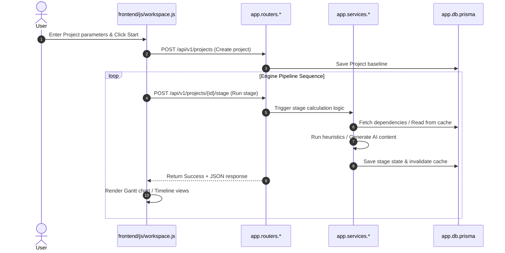

# 06. Core Workflows

This document maps the end-to-end trace of plan generation and target modification workflows.

---

## 1. End-to-End Generation Trace
The following sequence outlines how a project plan is generated across the 8-stage pipeline:

---

## 2. Targeted Editing & Transaction Rollback Workflow
When a user requests a change (e.g. *"Change the database to PostgreSQL in Milestone 2"*):

1. **Snapshot Creation:** The router makes a request to `ensure_backup()`, serializing current tasks and milestones (including group `order` values) and saving them to the `ProjectBackup` table.
2. **LLM Query:** The WBS structure and user prompt are sent to Ollama in a single API call.
3. **Collision Checks:** The output JSON array is checked for duplicate IDs, mapping colliding keys to new UUIDs and updating dependencies.
4. **Purge & Insert:** The existing tasks and groups are purged (`delete_many`) and recreated (`create_many`).
5. **Auto-Rollback Trigger:**
   * If any step fails (such as database unique violations or parser crashes), the `except Exception as loop_err:` block catches it.
   * The router calls `_rollback_backup()`, deleting the malformed records and writing the snapshot back to the database.
   * An HTTP 422 exception is raised with the traceback details, keeping the UI intact.
6. **User Reversion:** If the user rejects the generated changes in the frontend UI, clicking the "Revert" button triggers the `revert_section` endpoint, which restores the database using the same rollback mechanism.
