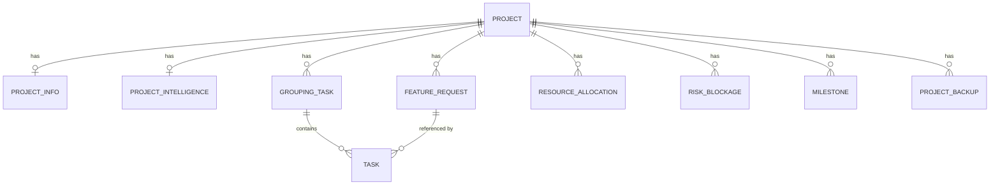

# 07. Database and LLM Contracts

The AI Planning Agent relies on a strict database schema and structured JSON output contracts from the LLM.

---

## 1. Database Schema Topology (`schema.prisma`)
The SQLite/PostgreSQL schema models the plan hierarchy:



* **`Project`**: The parent root container. Has relations to `ProjectInfo`, `ProjectIntelligence`, `FeatureRequest`, `GroupingTask` (milestones/sprints), `ResourceAllocation`, `RiskBlockage`, `Milestone`, and `ProjectBackup`.
* **`ProjectInfo`**: Stores metadata like project start date, deadline, budget, and architecture target.
* **`FeatureRequest`**: Holds scope elements extracted during the Analysis stage.
* **`GroupingTask`**: Represents a milestone phase or a sprint duration. Grouping tasks have a list of child `Task` records.
* **`Task`**: Represents development items. Includes scheduling fields (`scheduledStart`, `scheduledEnd`), dependencies, assignees, priorities, and effort hours.
* **`ProjectBackup`**: A key-value storage schema used to save pre-enhancement JSON states for fallback rollbacks.

---

## 2. LLM Prompt Construction Strategies
The prompt strategy is designed to ensure consistent JSON formats and project context:

1. **Context Insertion:** Every LLM prompt is injected with the project's active metadata (e.g. description, start date, budget, and database technology stack).
2. **Schema Definition Blocks:** Prompt templates define the exact JSON keys, data types, and array layouts expected in the response:
   ```json
   [
     {
       "id": "(string) Keep existing ID",
       "name": "(string) Group/Epic Name",
       "tasks": [
         {
           "id": "(string) task UUID",
           "title": "(string) Task Title",
           "estimatedHours": (float) effort hours,
           "priority": "high/medium/low",
           "status": "pending"
         }
       ]
     }
   ]
   ```
3. **Markdown Code Blocks Pre-processing:** To handle cases where Ollama wraps JSON in markdown block markers (e.g. ` ```json ... ``` `), the backend cleans the string inside `app/routers/enhancement.py` before parsing.
4. **Technology Stack Ingestion:** Prompts are injected with strict guidelines like:
   *"Do NOT change the technology stack. If the project uses PostgreSQL, all database tasks must refer to PostgreSQL. DO NOT introduce other databases like MongoDB, MySQL, etc."*
